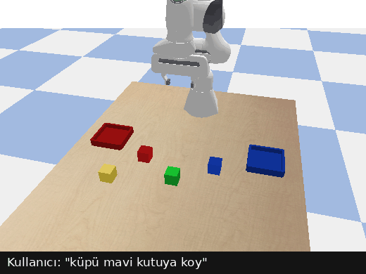
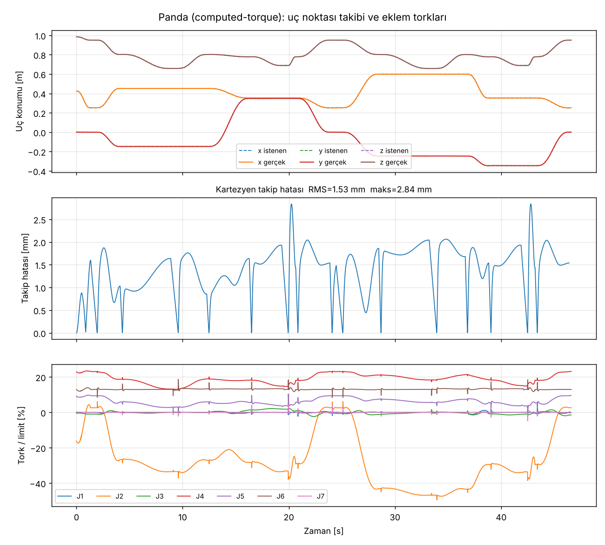
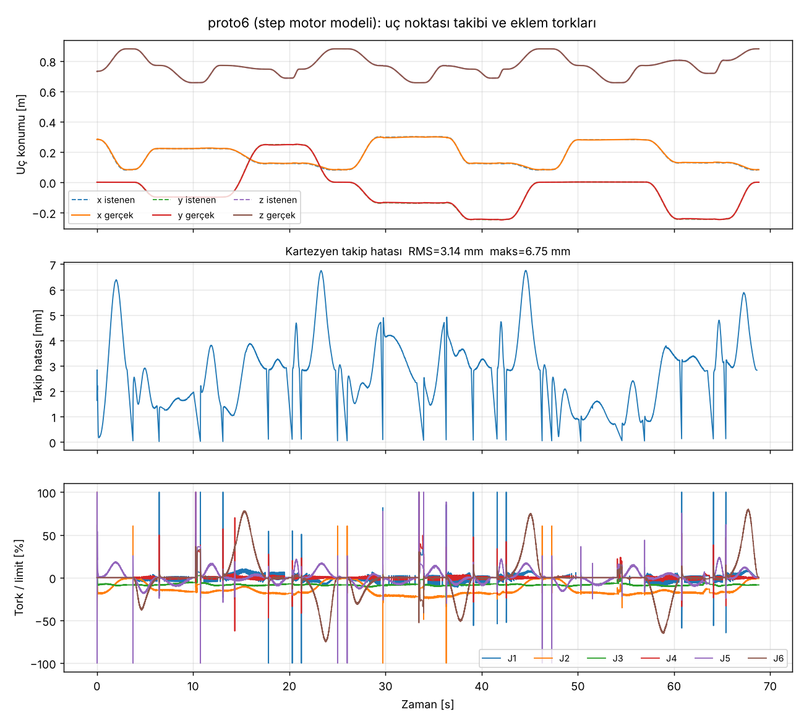
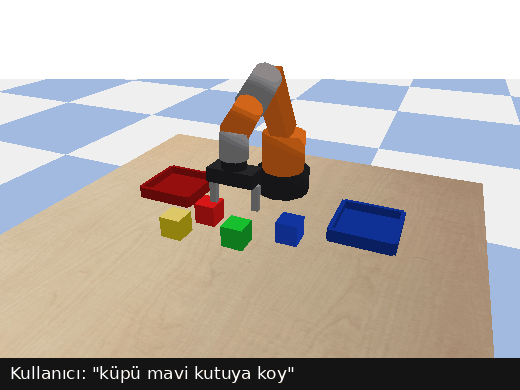

# 🎙️👁️🦾 Voice- and Vision-Guided Robot Arm

[🇹🇷 Türkçe](README.tr.md) · 

**A robot arm (in simulation) that takes spoken Turkish commands, finds objects with an RGB-D camera, and moves like a real manipulator, controlled with computed torque or step motors.**

> *"Önce yeşil küpü kırmızı kutuya koy, sonra sarı küpü onun üstüne koy."*
> ("First put the green cube in the red box, then put the yellow cube on top of it.")
> The robot splits the command into steps and finds the objects with its camera. It plans and tracks a trajectory for each move, then looks again to check the result. If the command is unclear, it asks a question.



## Highlights
- **End-to-end pipeline:** speech → text → task plan → perception → trajectory → joint control → visual verification
- **The robot only knows where objects are from its camera.** Simulator ground truth is used only for evaluation
- **Two arms, two control architectures:**
  - **Franka Panda**, controlled with computed torque using the full rigid-body dynamics
  - **proto6**, my own 6-DOF arm, modelled the way its real hardware works: step motors, gearbox torque and speed limits, step resolution, and saturation tracking to flag missed-step risk
- **Dialog:** asks when a command is ambiguous, remembers what it is holding, handles multi-step commands, pronouns and stacking
- **Measured:** every number below comes from a script in this repo

## Results
| Metric | Panda | proto6 | How |
|---|---|---|---|
| End-to-end task success (20 random scenes) | **20 / 20** | **20 / 20** | `scripts/evaluate.py --robot …` |
| Object detection rate | **100 %** | **100 %** | `scripts/evaluate.py` |
| 3D localization error (mean / p95) | **2.0 / 3.5 mm** | **1.9 / 3.1 mm** | `scripts/evaluate.py` |
| Cartesian tracking error (RMS / max) | **1.5 / 2.8 mm** | **3.1 / 6.8 mm** | `scripts/plot_tracking.py` |
| 4-cube tower | stands | stands | `tests/test_agent.py` |
| Command parsing, rule-based (50 commands) | **96 %** ¹ | | `scripts/eval_parser.py` |
| Command parsing, local LLM (qwen2.5:7b) | *to be measured* | | `scripts/eval_parser.py --parser llm` |
| Speech → command accuracy, WER | *to be measured* | | `scripts/eval_voice.py` |

¹ The rule-based parser was developed against this dataset, so the score is optimistic. The two commands it fails (English, negation) are kept on purpose to show where an LLM helps.
The simulator has ideal lighting, and real HSV thresholds need tuning. That is why the OWLv2 detector is included.

## Architecture
```
🎤 Mic ─► VAD ─► faster-whisper ─► text ─► Parser (rules | LLM) ─► [task, task, …]
                                                                        │
📷 RGB-D camera ─► Detector (HSV | OWLv2) ─► point cloud ─► 3D objects ─┤
                                                                        ▼
  Arm ◄── computed-torque | step-motor model ◄── IK + J⁺ ◄── quintic trajectory ◄── Agent
   │                                                                     ▲
   └──── grasp: finger contact force · verification: look again ─────────┘
```

### Control
- **Trajectory:** straight Cartesian line with a quintic time profile (zero velocity and acceleration at both ends), velocity- and acceleration-limited
- **Kinematics:** IK for joint positions, Jacobian pseudo-inverse for joint velocities
- **Panda, computed torque at 240 Hz:** `τ = M(q)(q̈_d + Kp·e + Kd·ė) + C(q,q̇)q̇ + g(q)`. The simulator's built-in motors are disabled and torques are clipped to the Panda datasheet limits
- **proto6, step motors:**
  - Commands are rounded to step resolution (1.8°, microstepping, gear ratio)
  - Each joint has gearbox-output torque and speed limits
  - The time each motor spends at its torque limit is recorded, because a real stepper would skip steps there. Finding: the base joint (NEMA17 + 20:1) is the weakest link
- **Gripper:** fingers are mechanically coupled so the object always centres. Without this coupling, stacked towers drifted about 1 cm per level. A grasp is detected from contact force on both fingers

<table><tr>
<td></td>
<td></td>
</tr></table>

### Perception
- Simulated RGB-D camera (eye-to-hand) → a 3D point in the robot base frame for every pixel
- **ColorDetector** (HSV, fast, offline) · **OwlDetector** (OWLv2, open-vocabulary, text queries like "a red cube")
- Cube vs. box is decided by **metric width** measured from the point cloud, so it does not depend on camera distance
- Object centres are taken from the top surface (solid objects) or the bounding box (hollow trays). This brought tray error down from 7.4 to 2.7 mm
- Moving to a real camera: `RealSenseCamera` + hand-eye calibration → [docs/calibration.md](docs/calibration.md)

### Language and dialog
- Multi-step commands (`önce … sonra …`, comma lists) and pronouns (`onu`, `onun üstüne`)
- Clarification: *"Hangi küp? Gördüklerim: kırmızı, sarı…"* ("Which cube? I see: red, yellow…"). The answer can be a colour, an index, or `iptal` (cancel)
- State: *"kırmızı küpü al"* ("pick up the red cube"), later *"mavi kutuya bırak"* ("drop it in the blue box")
- The rule-based parser and a local LLM (via Ollama) are interchangeable

## proto6: my own arm


A 6-DOF prototype arm I am designing for 3D-printed parts and step motors:
- 450 mm reach (shoulder to flange), 1 kg payload
- STM32F407 controller with DM542T drivers
- NEMA23 + 50:1 gearboxes on the shoulder and elbow, NEMA17 + 20:1 on the base

The URDF is generated parametrically by [`robots/proto6/generate_urdf.py`](robots/proto6/generate_urdf.py). Masses and inertias are computed from the geometry, and the limits come from the motor and gearbox specifications. **These values are estimates** and will be replaced with measured ones (and CAD meshes) as the hardware gets built. The rest of the stack works on either arm without changes, through `RobotInterface`.
<br clear="right"/>

## Setup
Python **3.11** is recommended (PyBullet ships prebuilt wheels for it).
```bash
python -m venv .venv
source .venv/bin/activate          # Windows: .venv\Scripts\activate
python -m pip install -r requirements.txt
```
Optional: [Ollama](https://ollama.com) + `ollama pull qwen2.5:7b` for the LLM parser · `python -m pip install torch transformers` for OWLv2

## Usage
```bash
python app.py [--robot proto6]                   # Gradio UI: mic, chat, robot camera, motion video
python scripts/run.py [--robot proto6]           # PyBullet window + terminal commands
python scripts/run.py --voice --llm              # microphone + LLM
python scripts/run.py --detector owl --seed 7    # OWLv2, random scene

python -m pytest -q tests                        # 60 tests
python scripts/evaluate.py --robot proto6        # perception + task metrics
python scripts/eval_parser.py [--parser llm]     # parser comparison
python scripts/record_voice_set.py               # record the 50 commands with your voice
python scripts/eval_voice.py                     # WER + speech→command accuracy
python scripts/plot_tracking.py                  # control plots
python scripts/make_demo_gif.py [--robot proto6] # demo GIFs
```

## Project layout
```
src/voicearm/
  executor.py          Agent: dialog, task execution, verification
  world.py             builds scene + arm + perception + agent
  nlp/parser.py        RuleParser, OllamaParser → [Task]
  stt/whisper_stt.py   microphone + VAD + faster-whisper, WER
  perception/          cameras (Sim, RealSense), detectors (HSV, OWLv2)
  sim/                 robots (Panda, proto6), controllers, scene, video recorder
robots/proto6/         parametric URDF generator for my arm
scripts/               run, evaluate, demo
data/commands.jsonl    50 Turkish commands with expected task lists
tests/                 unit + end-to-end scenario tests
```

## Next
- Real proto6 hardware: replace estimated parameters with measured ones, add CAD meshes, and drive it from STM32 over serial through `RobotInterface`
- RealSense camera + hand-eye calibration
- Fine-tune the LLM on the command set with QLoRA

## License
MIT
