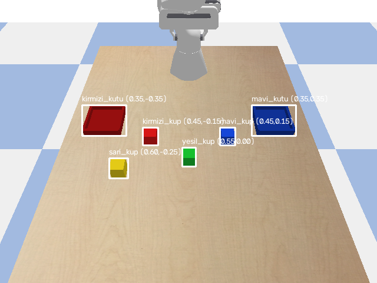

# 🎙️🦾 Voice-Controlled Robot Arm

**Türkçe sesli komutla çalışan, kamerayla gören ve gerçek bir manipülatör gibi kontrol edilen robot kol (simülasyon).**

> *"Önce yeşil küpü kırmızı kutuya koy, sonra sarı küpü onun üstüne koy."*
> Robot komutu adımlara ayırır, nesneleri kamerayla bulur, torkla kontrol edilen yörüngelerle taşır
> ve sonucu yeniden bakarak doğrular. Emin değilse soru sorar.


## Öne çıkanlar
- **Uçtan uca hat:** ses → metin → görev planı → algı → yörünge planlama → tork kontrolü → doğrulama
- **Robot nesnelerin yerini yalnızca kameradan öğrenir.** Simülasyonun gerçek konumları sadece değerlendirmede kullanılır
- **Gerçek kontrol yığını:** quintic yörünge + Jacobian + **computed-torque** kontrol, Panda tork limitleri
- **Diyalog:** eksik/belirsiz komutta geri soru sorar, elinde ne tuttuğunu hatırlar, çok adımlı komut ve istifleme yapar
- **Ölçülmüş:** tüm metrikler script'lerle yeniden üretilebilir

## Sonuçlar
| Metrik | Değer | Nasıl ölçülür |
|---|---|---|
| Uçtan uca görev başarısı (20 rastgele sahne) | **20 / 20** | `scripts/evaluate.py` |
| Nesne tespit oranı (120 nesne) | **%100** | `scripts/evaluate.py` |
| 3D konum hatası (ortalama / %95) | **3.6 mm / 4.7 mm** | `scripts/evaluate.py` |
| Kartezyen takip hatası (RMS / maks) | **1.7 mm / 3.0 mm** | `scripts/plot_tracking.py` |
| Komut ayrıştırma, kural tabanlı (50 komut) | **%96** ¹ | `scripts/eval_parser.py` |
| Komut ayrıştırma, LLM (qwen2.5:7b) | ölçülecek | `scripts/eval_parser.py --parser llm` |
| Ses → komut doğruluğu, WER | ölçülecek | `scripts/record_voice_set.py` + `eval_voice.py` |

¹ Kural tabanlı ayrıştırıcı bu veri seti üzerinde geliştirildi, skor iyimserdir. Başarısız olduğu 2 komut (İngilizce, olumsuzluk) LLM'in farkını göstermek için bilerek setin içinde.
Simülasyon ışığı idealdir; gerçek ortamda HSV eşikleri ayar ister (bu yüzden OWLv2 seçeneği var).

## Mimari
```
🎤 Mikrofon ─► VAD ─► faster-whisper ─► metin ─► Ayrıştırıcı (kural | LLM) ─► [görev, görev, ...]
                                                                                    │
📷 RGB-D kamera ─► Dedektör (HSV | OWLv2) ─► nokta bulutu ─► 3D nesne listesi ──────┤
                                                                                    ▼
   Robot ◄── computed-torque (240 Hz) ◄── IK + J⁺ ◄── quintic yörünge ◄── Agent (diyalog, durum)
     │                                                                              ▲
     └──────────── kavrama: parmak temas kuvveti · doğrulama: yeniden algılama ─────┘
```

### Kontrol
1. **Yörünge planlama:** Kartezyen düz çizgi, quintic zaman profili (uçlarda hız/ivme sıfır, hız ve ivme limitli)
2. **Kinematik:** her adımda IK ile istenen eklem açıları, Jacobian sözde-tersi ile istenen eklem hızları
3. **Computed-torque:** `τ = M(q)(q̈_d + Kp·e + Kd·ė) + C(q,q̇)q̇ + g(q)`. Simülatörün kendi motorları kapalı, tork Panda datasheet limitlerinde kırpılır
4. **Gripper:** kuvvet sınırlı. Kavrama, iki parmaktaki temas kuvvetinden algılanır


### Algı
- Simüle RGB-D kamera (eye-to-hand) → her piksel için robot tabanı koordinatlarında 3D nokta
- **ColorDetector** (HSV, offline, hızlı) · **OwlDetector** (OWLv2, metinle açık sözlüklü tespit)
- Küp/kutu ayrımı, nokta bulutundan ölçülen **metrik genişlikle** yapılır (kamera mesafesinden bağımsız)
- Gerçek kameraya geçiş: `RealSenseCamera` + el-göz kalibrasyonu → [docs/calibration.md](docs/calibration.md)



### Dil ve diyalog
- Çok adımlı komutlar (`önce … sonra …`, virgülle sıralama), zamir çözümleme (`onu`, `onun üstüne`)
- Eksik bilgide soru: *"Hangi küp? Gördüklerim: kırmızı, sarı…"*. Cevap renk, sıra numarası ya da `iptal` olabilir
- Durum: *"kırmızı küpü al"* … *"mavi kutuya bırak"*. Elinde tuttuğunu hatırlar
- Kural tabanlı ayrıştırıcı ile Ollama üzerinden yerel LLM aynı arayüzle değiştirilebilir

## Kurulum
Python **3.11** önerilir (PyBullet için hazır paket).
```bash
python -m venv .venv
source .venv/bin/activate          # Windows: .venv\Scripts\activate
python -m pip install -r requirements.txt
```
İsteğe bağlı: LLM için [Ollama](https://ollama.com) + `ollama pull qwen2.5:7b` · OWLv2 için `python -m pip install torch transformers`

## Kullanım
```bash
python app.py                                   # Gradio arayüzü: mikrofon, kamera, hareket videosu
python scripts/run.py                           # PyBullet penceresi + terminalden komut
python scripts/run.py --voice --llm             # mikrofon + LLM
python scripts/run.py --detector owl --seed 7   # OWLv2, rastgele sahne

python -m pytest -q tests                       # testler
python scripts/evaluate.py --trials 20          # algı + görev metrikleri
python scripts/eval_parser.py [--parser llm]    # ayrıştırıcı kıyası
python scripts/record_voice_set.py              # 50 komutu sesli kaydet
python scripts/eval_voice.py                    # WER + ses→komut doğruluğu
python scripts/plot_tracking.py                 # kontrol grafikleri
python scripts/make_demo_gif.py                 # docs/demo.gif
```

## Proje yapısı
```
src/voicearm/
  executor.py          Agent: diyalog, görev yürütme, doğrulama
  nlp/parser.py        RuleParser, OllamaParser → [Task]
  stt/whisper_stt.py   mikrofon + VAD + faster-whisper, WER
  perception/          kameralar (Sim, RealSense), dedektörler (HSV, OWLv2)
  sim/                 sahne, Panda + kontrolcü, yörünge, video kaydı
scripts/               çalıştırma, değerlendirme, demo
data/commands.jsonl    50 Türkçe komut + beklenen görevler
tests/                 birim + uçtan uca senaryo testleri
```

## Sıradakiler
- Kendi 6 eksenli kolumun URDF'i ile Panda'nın değiştirilmesi (`RobotInterface` buna hazır)
- RealSense ile gerçek kamera testi ve el-göz kalibrasyonu
- Komut setinde LLM'in QLoRA ile ince ayarı

## Lisans
MIT
