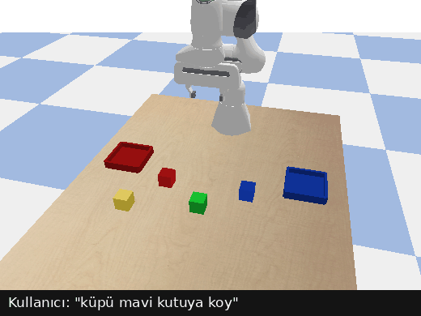
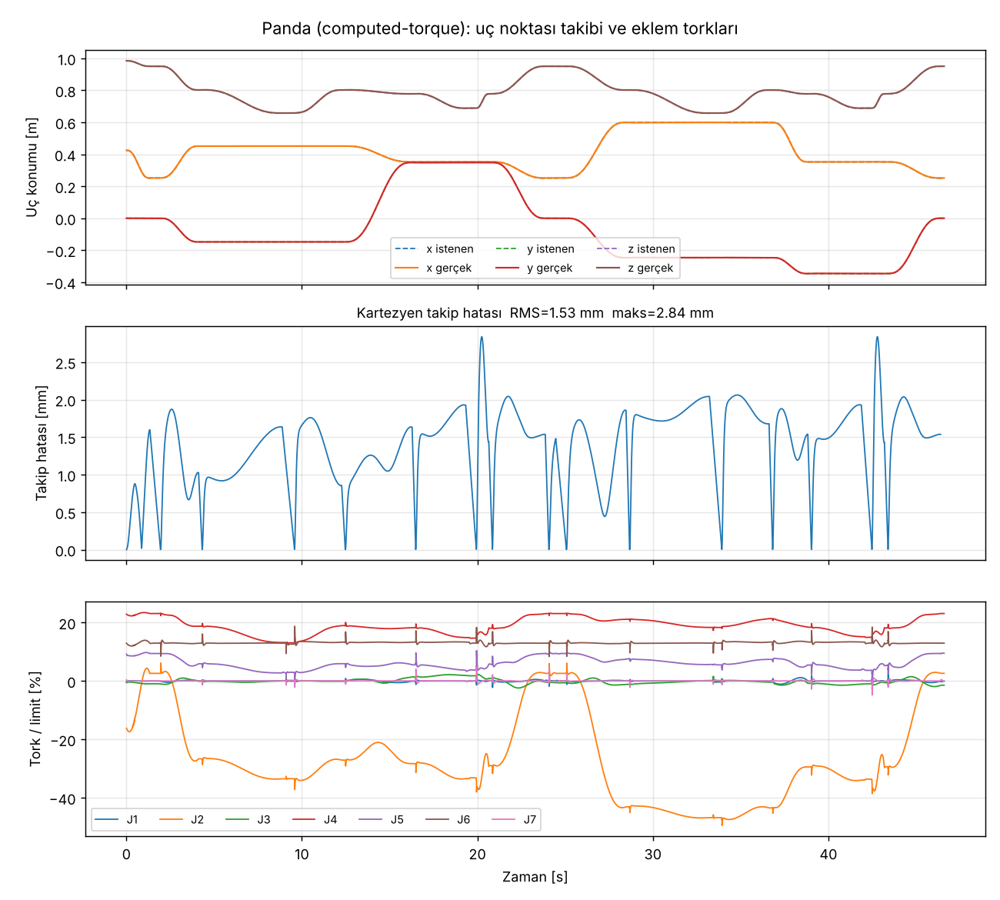
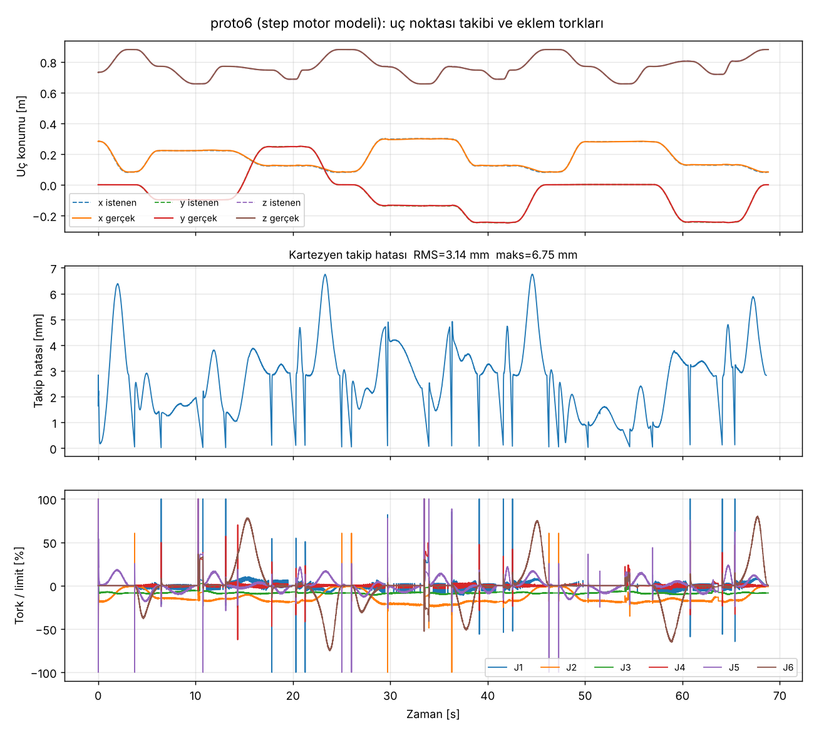
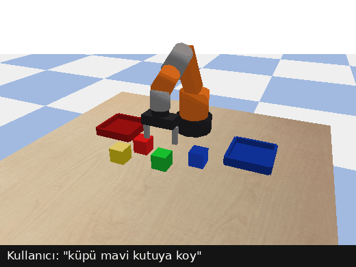

# 🎙️👁️🦾 Sesli ve Görü Güdümlü Robot Kol

[🇬🇧 English](README.md)

**Türkçe sesli komutla çalışan, RGB-D kamerayla gören ve gerçek bir manipülatör gibi (computed-torque ya da step motor modeliyle) kontrol edilen robot kol (simülasyon).**

> *"Önce yeşil küpü kırmızı kutuya koy, sonra sarı küpü onun üstüne koy."*
> Robot komutu adımlara ayırır ve nesneleri kamerayla bulur. Her hareket için yörünge planlayıp takip eder, sonra tekrar bakarak sonucu doğrular. Emin değilse soru sorar.



## Öne çıkanlar
- **Uçtan uca hat:** ses → metin → görev planı → algı → yörünge → eklem kontrolü → görsel doğrulama
- **Robot nesnelerin yerini yalnızca kameradan öğrenir.** Simülasyonun gerçek konumları sadece değerlendirmede kullanılır
- **İki kol, iki kontrol mimarisi:**
  - **Franka Panda**, tam katı cisim dinamiğiyle computed-torque kontrol
  - **proto6**, kendi 6 eksenli kolum, gerçek donanımı gibi modellendi: step motorlar, redüktör tork ve hız limitleri, adım çözünürlüğü, adım kaçırma riskini gösteren doyum takibi
- **Diyalog:** belirsizlikte soru sorar, elinde ne tuttuğunu hatırlar, çok adımlı komut, zamir ve istifleme destekler
- **Ölçülmüş:** aşağıdaki her sayı repodaki bir script'le yeniden üretilebilir

## Sonuçlar
| Metrik | Panda | proto6 | Nasıl |
|---|---|---|---|
| Uçtan uca görev başarısı (20 rastgele sahne) | **20 / 20** | **20 / 20** | `scripts/evaluate.py --robot …` |
| Nesne tespit oranı | **%100** | **%100** | `scripts/evaluate.py` |
| 3D konum hatası (ort. / %95) | **2.0 / 3.5 mm** | **1.9 / 3.1 mm** | `scripts/evaluate.py` |
| Kartezyen takip hatası (RMS / maks) | **1.5 / 2.8 mm** | **3.1 / 6.8 mm** | `scripts/plot_tracking.py` |
| 4 katlı küp kulesi | ayakta | ayakta | `tests/test_agent.py` |
| Komut ayrıştırma, kural tabanlı (50 komut) | **%96** ¹ | | `scripts/eval_parser.py` |
| Komut ayrıştırma, yerel LLM (qwen2.5:7b) | *ölçülecek* | | `scripts/eval_parser.py --parser llm` |
| Ses → komut doğruluğu, WER | *ölçülecek* | | `scripts/eval_voice.py` |

¹ Kural tabanlı ayrıştırıcı bu veri seti üzerinde geliştirildi, skor iyimserdir. Başarısız olduğu 2 komut (İngilizce, olumsuzluk) LLM'in farkını göstermek için bilerek setin içinde.
Simülasyon ışığı idealdir; gerçek ortamda HSV eşikleri ayar ister. OWLv2 seçeneği bu yüzden var.

## Mimari
```
🎤 Mikrofon ─► VAD ─► faster-whisper ─► metin ─► Ayrıştırıcı (kural | LLM) ─► [görev, görev, …]
                                                                                  │
📷 RGB-D kamera ─► Dedektör (HSV | OWLv2) ─► nokta bulutu ─► 3D nesneler ─────────┤
                                                                                  ▼
  Kol ◄── computed-torque | step motor modeli ◄── IK + J⁺ ◄── quintic yörünge ◄── Agent
   │                                                                              ▲
   └──── kavrama: parmak temas kuvveti · doğrulama: yeniden bakma ────────────────┘
```

### Kontrol
- **Yörünge:** Kartezyen düz çizgi, quintic zaman profili (uçlarda hız ve ivme sıfır), hız ve ivme limitli
- **Kinematik:** eklem açıları için IK, eklem hızları için Jacobian sözde-tersi
- **Panda, computed-torque (240 Hz):** `τ = M(q)(q̈_d + Kp·e + Kd·ė) + C(q,q̇)q̇ + g(q)`. Simülatörün kendi motorları kapalı, torklar Panda datasheet limitlerinde kırpılır
- **proto6, step motor:**
  - Komutlar adım çözünürlüğüne yuvarlanır (1.8°, mikro adım, redüktör oranı)
  - Her eklemde redüktör çıkışı tork ve hız limiti var
  - Motorun tork limitinde geçirdiği süre kaydedilir; gerçek bir step motor tam bu anlarda adım kaçırır. Bulgu: en zayıf halka taban eklemi (NEMA17 + 20:1)
- **Gripper:** parmaklar mekanik olarak bağlı, nesne hep ortaya oturur. Bu bağ olmadan istiflenen kuleler kat başına ~1 cm kayıyordu. Kavrama iki parmaktaki temas kuvvetinden algılanır

<table><tr>
<td></td>
<td></td>
</tr></table>

### Algı
- Simüle RGB-D kamera (eye-to-hand) → her piksel için robot tabanı koordinatlarında 3D nokta
- **ColorDetector** (HSV, offline, hızlı) · **OwlDetector** (OWLv2, metinle açık sözlüklü tespit, ör. "a red cube")
- Küp/kutu ayrımı nokta bulutundan ölçülen **metrik genişlikle** yapılır, kamera mesafesinden bağımsızdır
- Merkez, dolu nesnelerde üst yüzeyden, içi boş tepsilerde sınır kutusundan hesaplanır. Bu, tepsi hatasını 7.4 mm'den 2.7 mm'ye indirdi
- Gerçek kameraya geçiş: `RealSenseCamera` + el-göz kalibrasyonu → [docs/calibration.md](docs/calibration.md)

### Dil ve diyalog
- Çok adımlı komutlar (`önce … sonra …`, virgülle sıralama) ve zamirler (`onu`, `onun üstüne`)
- Eksik bilgide soru: *"Hangi küp? Gördüklerim: kırmızı, sarı…"*. Cevap renk, sıra numarası ya da `iptal` olabilir
- Durum takibi: *"kırmızı küpü al"*, ardından *"mavi kutuya bırak"*
- Kural tabanlı ayrıştırıcı ile yerel LLM (Ollama) aynı arayüzle değiştirilebilir

## proto6: kendi kolum


3B baskı parçalar ve step motorlarla tasarladığım 6 eksenli prototip kol:
- 450 mm erişim (omuzdan flanşa), 1 kg yük
- STM32F407 kontrolcü ve DM542T sürücüler
- Omuz ve dirsekte NEMA23 + 50:1, tabanda NEMA17 + 20:1 redüktör

URDF dosyası [`robots/proto6/generate_urdf.py`](robots/proto6/generate_urdf.py) ile parametrik olarak üretilir. Kütle ve eylemsizlikler geometriden hesaplanır, limitler motor ve redüktör özelliklerinden gelir. **Bu değerler tahminidir**; donanım ilerledikçe ölçülen değerler ve CAD parçaları ile güncellenecek. Yazılımın geri kalanı `RobotInterface` sayesinde iki kolda da değişmeden çalışır.
<br clear="right"/>

## Kurulum
Python **3.11** önerilir (PyBullet için hazır paket).
```bash
python -m venv .venv
source .venv/bin/activate          # Windows: .venv\Scripts\activate
python -m pip install -r requirements.txt
```
İsteğe bağlı: LLM için [Ollama](https://ollama.com) + `ollama pull qwen2.5:7b` · OWLv2 için `python -m pip install torch transformers`

## Kullanım
```bash
python app.py [--robot proto6]                   # Gradio arayüzü: mikrofon, sohbet, kamera, hareket videosu
python scripts/run.py [--robot proto6]           # PyBullet penceresi + terminalden komut
python scripts/run.py --voice --llm              # mikrofon + LLM
python scripts/run.py --detector owl --seed 7    # OWLv2, rastgele sahne

python -m pytest -q tests                        # 60 test
python scripts/evaluate.py --robot proto6        # algı + görev metrikleri
python scripts/eval_parser.py [--parser llm]     # ayrıştırıcı kıyası
python scripts/record_voice_set.py               # 50 komutu sesli kaydet
python scripts/eval_voice.py                     # WER + ses→komut doğruluğu
python scripts/plot_tracking.py                  # kontrol grafikleri
python scripts/make_demo_gif.py [--robot proto6] # demo GIF'leri
```

## Proje yapısı
```
src/voicearm/
  executor.py          Agent: diyalog, görev yürütme, doğrulama
  world.py             sahne + kol + algı + ajanı kurar
  nlp/parser.py        RuleParser, OllamaParser → [Task]
  stt/whisper_stt.py   mikrofon + VAD + faster-whisper, WER
  perception/          kameralar (Sim, RealSense), dedektörler (HSV, OWLv2)
  sim/                 kollar (Panda, proto6), kontrolcüler, sahne, video kaydı
robots/proto6/         kendi kolumun parametrik URDF üreticisi
scripts/               çalıştırma, değerlendirme, demo
data/commands.jsonl    50 Türkçe komut + beklenen görevler
tests/                 birim + uçtan uca senaryo testleri
```

## Sıradakiler
- Gerçek proto6 donanımı: tahmini parametreleri ölçülenlerle ve CAD parçalarıyla değiştirmek, STM32'yi seri port üzerinden `RobotInterface` ile sürmek
- RealSense kamera + el-göz kalibrasyonu
- Komut setinde LLM'in QLoRA ile ince ayarı

## Lisans
MIT
